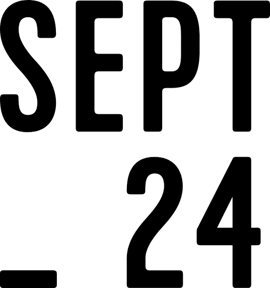

# Analyse du domaine — Aaron Roeung

## Découverte de soi

- Mes forces : créativité, adaptabilité, débrouillard, perfectionniste
    - Exemple : autoportraits illustration numérique
- Mes faiblesses ou points à améliorer : communication, patience, confiance
    - Exemple : parler devant la classe
- Seul(e) ou en équipe : équipe
    - Pourquoi et exemple : J'aime parler avec mes coéquipiers pendant le travail. Exemple: Aide collaboratif en photographie
- Plutôt technique ou créatif : créatif

## Exploration des domaines

| Domaine | Intérêt | Pourquoi |
|---|---|---|
| Graphisme | fort | Je peux utiliser ma créativité en illustration et j'ai déjà des compétences en graphisme |
| Vidéo et animation 2D | fort | Je peux créer des vidéos selon mes propres idées (créativité) et j'ai déja des compétences en montage de vidéo |
| 3D | moyen | Je suis curieux de créer des modèles 3D mais je n'ai pas vraiment touché à des logiciels de 3D |
| Web | faible | Je ne suis pas intéressé à créer des sites web |
| Jeux vidéo | fort | J'adore les jeux vidéo et j'ai toujours voulu créer mon propre jeu |
| Développement logiciel | moyen | Assez intéressant, mais ce n'est pas un domaine qui me passionne autant que les autres |
| Installations et expériences immersives | moyen | Ce n'est pas vraiment quelque chose qui me passionne mais je trouve ca intéressant |

## Mes 2 domaines préférés

### Domaine 1 : Vidéo

- Expérience : J'ai appris comment utiliser des logiciels de montage de vidéo il y a longtemps et j'ai monté quelques vidéos pour un stage en soutien informatique
- Logiciels et outils : Adobe Premiere Pro, Adobe After Effects, Adobe Media Encoder
- Pourquoi il m'intéresse : J'ai déjà monté plusieurs vidéos quand j'étais jeune et j'adore utiliser mes propres idées comme inspiration dans ces vidéos
- Travailler dans ce domaine : Je me vois travailler dans ce domaine, car c'est le domaine qui me passionne le plus et j'aimerais utiliser mes compétences dans le marché du travail.

### Domaine 2 : Illustration numérique

- Expérience : J'ai déjà de l'expérience en illustration. J'ai appris quelques logiciels de graphisme auparavant quand j'étais jeune et dans mon ancien DEP en soutien informatique.
- Logiciels et outils : Adobe Illustrator, Adobe Photoshop
- Pourquoi il m'intéresse : J'ai déja créé plusieurs oeuvres auparavant, même durant cette session. J'adore utiliser ma créativité et mes idées pour ces projets.
- Travailler dans ce domaine : Malgré mes compétences et mes intérêts dans ce domaine, je me vois plus comme monteur de vidéo, donc je ne me vois pas travailler dans ce domaine.

## Les caractéristiques de mon domaine préféré

- Types d'entreprises : Studios de création audiovisuel, studios de développement, agences de marketing.
- Exemple d'entreprise : Sept24

(source de l'image : [Source](https://sept24.com/))

- Types de produits et de services : Contenu audiovisuel: vidéo, audio, effets spéciaux
- Étapes de production : Idéation, préproduction, production, postproduction, opération
- Type d'emploi visé : Monteur vidéo
- Étapes pour obtenir cet emploi : Compléter DEC en multimédia, avoir un portfolio avec mon expérience, compléter un stage, trouver un emploi

## Conclusion

- Mon profil en une phrase : Je suis un créateur organisé qui veut concevoir des montages de vidéo
- Ce qui m'a surpris : ...
- Ma force principale et la faiblesse à travailler : Mon perfectionnisme et ma communication orale
- Mon action d'ici la fin de la session : Compléter un tutoriel sur l'utilisation de After Effects

## Ma capsule

